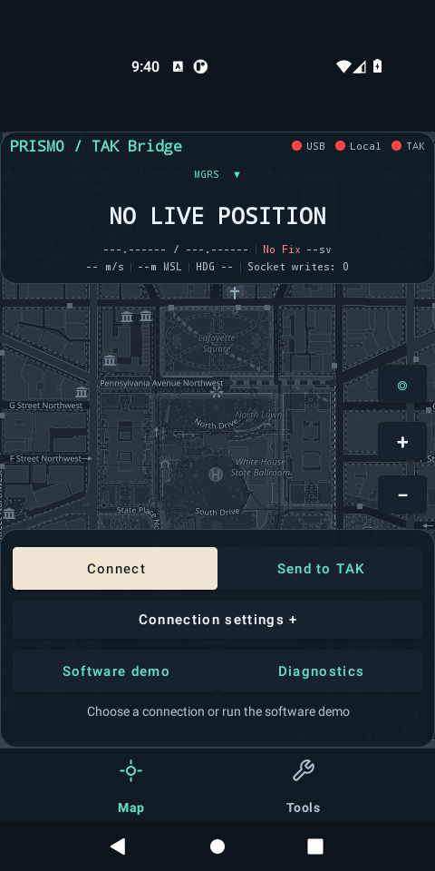
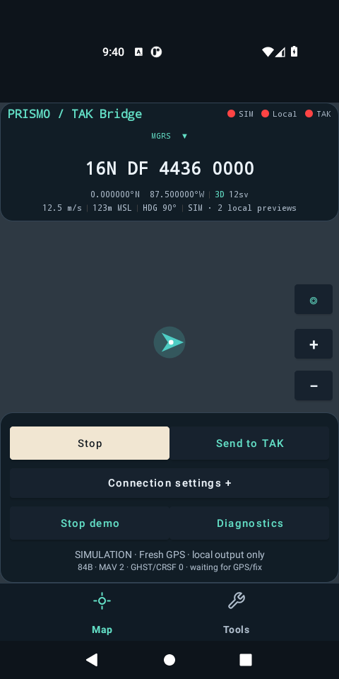
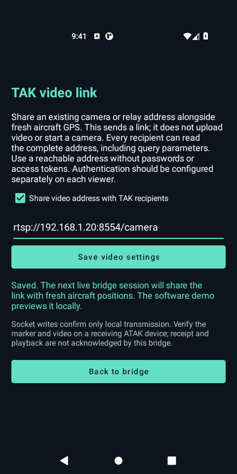

# TAK Bridge

**Bring an existing aircraft GPS stream into TAK from an Android phone or tablet.**

TAK Bridge reads supported MAVLink, MSP and GHST/CRSF telemetry over USB, shows the aircraft position, and sends Cursor on Target (CoT) updates to a TAK client or server. It can attach an existing RTSP video address to the aircraft marker. The app also includes map and RF planning tools.

## Download the beta

**[Download TAK Bridge 0.5.0-beta.1 for Android](https://github.com/DroneWuKong/MultiProtocol-UAS-TAK-Bridge/releases/download/v0.5.0-beta.1/TAK-Bridge-0.5.0-beta.1.apk)** · [Release notes and checksums](https://github.com/DroneWuKong/MultiProtocol-UAS-TAK-Bridge/releases/tag/v0.5.0-beta.1)

Requires **Android 8.0 or later**. USB telemetry also requires USB host/OTG support and a data cable. Install the **APK** release asset; the source-code ZIP does not install an Android app.

The app appears as **TAK Bridge Beta**. It has its own package and settings, so it can coexist with an older TAK Bridge installation. It is signed with a persistent beta key and has debugging disabled. See [installation, updates and signing details](docs/BETA_RELEASE.md).

| Start here | Read online | Download PDF |
| --- | --- | --- |
| Three-page quick start | [Quick start](docs/QUICK_START.md) | [Quick start PDF](https://github.com/DroneWuKong/MultiProtocol-UAS-TAK-Bridge/releases/download/v0.5.0-beta.1/TAK_Bridge_Quick_Start.pdf) |
| Illustrated eight-page manual | [User manual](docs/USER_MANUAL.md) | [User manual PDF](https://github.com/DroneWuKong/MultiProtocol-UAS-TAK-Bridge/releases/download/v0.5.0-beta.1/TAK_Bridge_User_Manual.pdf) |

## Your first five minutes

1. **Install:** download the APK on your Android device and open it. If prompted, allow your browser or file manager to install the app, then follow the device prompts. Keep normal device protections enabled.
2. **Practice:** launch **TAK Bridge Beta → Software demo**. Watch the synthetic position and GPS freshness change. No USB source or TAK server is needed; demo positions stay local.
3. **Connect:** tap **Stop demo**, open **Connection settings**, and match the profile, protocol and baud to an existing GPS telemetry stream. Connect a USB data cable, tap **Connect**, select the serial port if asked and grant USB access.
4. **Check GPS:** confirm fresh coordinates and a valid source fix. An open USB port or increasing byte count does not prove GPS reception.
5. **Send to TAK:** configure Local TAK or your server as described below. Verify the marker and location on the receiving device. Use **Stop** when finished; switching apps does not stop an active session.

## See the app

<p>
  
  
  
</p>

These are **real screenshots of the signed release APK running on an Android emulator**, captured without image edits. Demo data is synthetic. They do not show a physical aircraft, USB connection or receiving TAK client. [Capture details and hashes](docs/guide-assets/beta-0.5.0/captures.json).

## Send data to ATAK / TAK

```text
Existing aircraft GPS stream → Android USB → TAK Bridge → CoT → TAK receiver
                                               ↑
                                  Optional existing RTSP address
```

- **Local TAK:** enable Local TAK before starting USB. Its default multicast destination is `239.2.3.1:6969`; configure the receiving client for that group and port. Wi-Fi isolation, multicast filtering and VPNs can prevent delivery.
- **TAK Server:** enter the server hostname and port, then tap **Send to TAK**. Use the port and routing your server administrator supplies; 8087 is the default TCP port.
- **TLS:** enable TLS, open **Certificates**, and import the client `.p12` and any required server CA. The server hostname must match its certificate. Certificate passwords remain in memory and must be re-entered after the process ends.

Only fresh, valid aircraft GPS generates new position events. **Socket writes** counts successful local transport writes; it does not confirm server acceptance or ATAK display. Check the receiving client. Diagnostics include last-write timestamps, expired-event counts and connection state without exporting coordinates, credentials or the video address.

Aircraft identities persist across callsign changes. Display coordinates can cycle through MGRS, decimal degrees, DMS and UTM; CoT always uses decimal degrees. Old positions expire according to the receiving client's handling of CoT timestamps.

### Attach a video link

Stop the session, open **Connection settings → TAK video link**, enable sharing and save an existing RTSP address reachable from the receiver. Restart telemetry. Fresh position events now include that link on the same aircraft marker.

**The public beta shares the address; it does not display, host or relay video.** Verify playback in the receiving TAK client. Do not put credentials or access tokens in the shared address. Disabling sharing clears the saved address and requests remote removal on the next valid position update.

See [publishing behavior, video removal and delivery evidence](docs/TAK_PUBLISHING.md).

## Supported inputs and tools

| Input | Behavior |
| --- | --- |
| MAVLink v1/v2 | Reads supported upstream GPS messages |
| MSP v1/v2 | Passive by default; the explicit Direct FC MSP polling profile requests GPS at 2 Hz |
| GHST / CRSF | Reads supported GPS frames from an existing compatible telemetry stream |

Auto mode listens passively and locks onto decoded GPS. Match baud, USB interface and stream configuration to your source. The app does not enable a transmitter's telemetry feature or turn channel/stick data into GPS.

The **Tools** tab includes channel planning, range and Fresnel estimates, antenna calculators, terrain links and mesh planning. Its code and catalogs are bundled. Online map imagery and elevation require network access; supported local DEM imports can supply offline elevation. Estimates are planning aids, not measurements.

## Beta status

This release adds opt-in RTSP link sharing, persistent aircraft IDs, clearer delivery diagnostics, and stricter position/XML validation. [Changelog](CHANGELOG.md).

Validation includes 56 passing native tests, debug and beta builds, lint with no errors, browser tool checks, signature/manifest checks, and interaction with the installed signed APK on an emulator. Physical USB/GPS, screen-off endurance, deployed TAK routing and receiving-device marker/video playback still require bench validation. [Release evidence, observed UI limitations and remaining checks](docs/BETA_RELEASE.md).

No vendor APK, proprietary accessory decoder or vendor resources were added to this public change. Existing upstream attribution remains. [Provenance scope](docs/TAK_PUBLISHING.md#sources-and-provenance-scope) · [Naming policy](docs/NAMING_POLICY.md). The repository does not currently declare a root project license; bundled dependencies retain their own licenses.

For a bug report, include the beta version, Android version, protocol, reproduction steps and exported diagnostics. [Open an issue](https://github.com/DroneWuKong/MultiProtocol-UAS-TAK-Bridge/issues). Remove private addresses, keys and locations from any extra logs or screenshots.

## Build and contribute

Use JDK 17, Android SDK 35 and the checked-in Gradle wrapper:

```sh
./gradlew testDebugUnitTest assembleDebug lintDebug --no-daemon
python3 tools/verify_build.py
```

Debug output: `app/build/outputs/apk/debug/app-debug.apk`. For the signed beta build and verification scripts, see [maintainer instructions](docs/BETA_RELEASE.md#build-a-beta).

```sh
npm ci --prefix tools/ui-tests
cd tools/ui-tests
npx playwright install --with-deps chromium
npm test
```

To regenerate the illustrated guides, create a Python virtual environment, install `tools/requirements-docs.txt`, ensure DejaVu Sans fonts are installed, and run `python tools/generate_guides.py`. Copy is maintained in `tools/guide_content.py`; screenshots and their provenance are committed under `docs/guide-assets/beta-0.5.0/`.

Key components: `bridge/BridgeSession` owns sessions; `mavlink/ProtocolRouter` routes telemetry; `cot/TakPublication` builds publication data; `transport/TakSender` handles outputs; `ui/MainActivity` hosts Map and Tools. Dependencies include [usb-serial-for-android](https://github.com/mik3y/usb-serial-for-android), [NGA MGRS](https://ngageoint.github.io/mgrs-android/), [OSMDroid](https://github.com/osmdroid/osmdroid), AndroidX and Kotlin Coroutines.

This is a telemetry bridge and planning app. It does not command aircraft, change flight modes or modify flight-controller parameters. Part of the [AI Wingman](https://github.com/DroneWuKong/Ai-Project) ecosystem; it runs independently.
