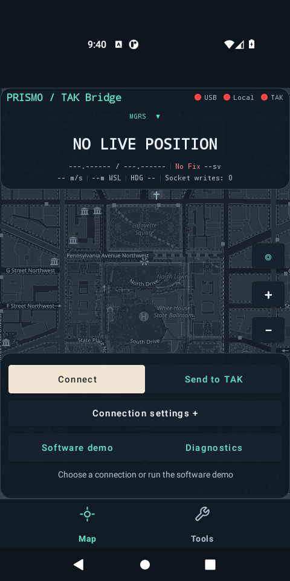
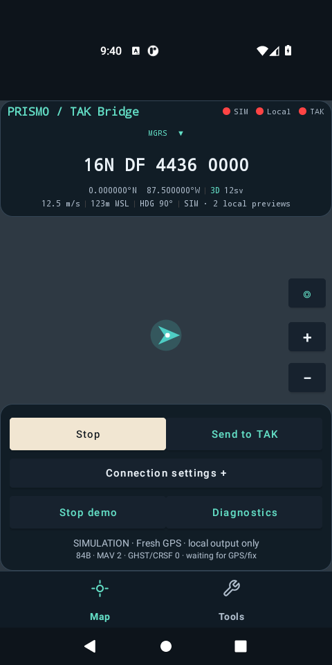
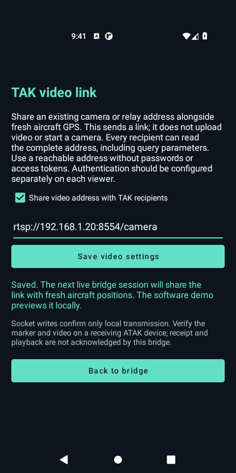

# TAK Bridge Quick Start

Prismo / TAK Bridge · Beta 0.5.0-beta.1

## 01. Install and try it

### 1 / Download the APK

Open the <a href="https://github.com/DroneWuKong/MultiProtocol-UAS-TAK-Bridge/releases/tag/v0.5.0-beta.1" color="#147463">GitHub beta release</a> on your Android device. Under Assets, choose **TAK-Bridge-0.5.0-beta.1.apk**. The source-code ZIP is for developers; it does not install the app.

### 2 / Install TAK Bridge Beta

Open the downloaded APK. If Android asks, allow your browser or file manager to install this app, then follow the device prompts. Android 8.0 or later is required. Keep normal device protections enabled.

The beta has its own icon and settings. It can coexist with an older TAK Bridge install. Future beta updates must use the same signing key; installing over this beta preserves its app data.

### 3 / Try Software demo

Open **TAK Bridge Beta** and tap **Software demo**. No USB device, TAK server or camera is needed. Watch the coordinates, marker and GPS status. Tap **Stop demo** when finished.

> **Practice stays local** — Demo positions are synthetic. The demo does not send them to a network. Map tile downloads still use the internet; missing tiles do not stop telemetry parsing.

## 02. From demo to live telemetry

### 1 / Finish local practice

The demo cycles fresh GPS, silence and no-fix packets. Watch publishing pause when GPS becomes stale. Open Diagnostics for a local CoT preview, then tap **Stop demo**.

### 2 / Connect your source

Use a USB host/OTG Android device and data cable. In **Connection settings**, select the profile, protocol and baud matching your existing aircraft GPS stream. Set a callsign, close settings and tap **Connect**. Select a port and grant USB access if prompted.

### 3 / Confirm fresh GPS

Check coordinates and a valid source fix. Bytes alone do not prove GPS. Auto mode is passive; only the Direct FC MSP polling profile requests GPS. Stop before changing connection settings.

> **Demo is not a hardware test** — This screenshot shows synthetic data. Validate your real USB interface, cable and aircraft GPS before relying on the bridge.

## 03. Verify TAK and video

### 1 / Choose the destination

For local reception, enable **Local TAK** before connecting USB and configure the receiver for **239.2.3.1:6969**. For a server, enter its hostname/port and tap **Send to TAK**. TLS needs appropriate certificates, trust and a matching hostname.

### 2 / Check the receiving device

With fresh GPS, confirm the correct aircraft marker and changing location in TAK. **Socket writes** proves only a local write, not server acceptance or ATAK display.

### 3 / Optionally attach video

Stop, open **Connection settings → TAK video link**, enable sharing and save an existing reachable RTSP address. Restart telemetry, then check the marker’s video link and playback on the receiver. This app shares a link; it does not host or display the feed.

### 4 / Finish the session

Use **Stop** or the notification action. To remove a video link, disable sharing and publish a new valid position. See the full manual for TLS setup and troubleshooting.

> **Beta validation** — Physical USB/GPS and receiving TAK/video playback remain unqualified. These screenshots show the signed app on an emulator, not a live deployment.
