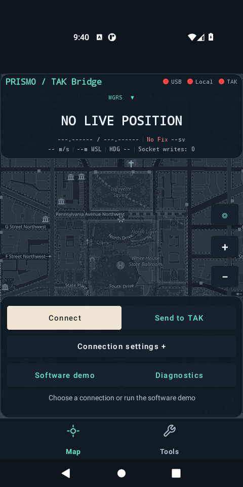
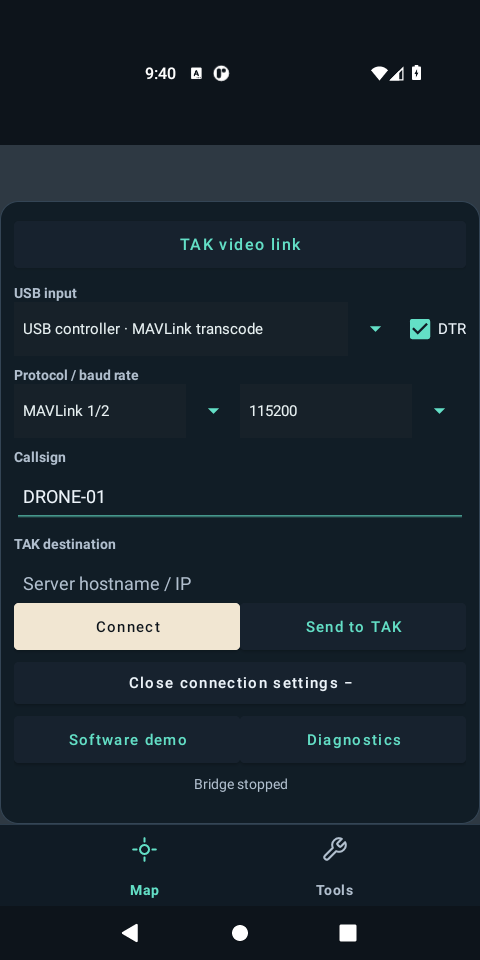
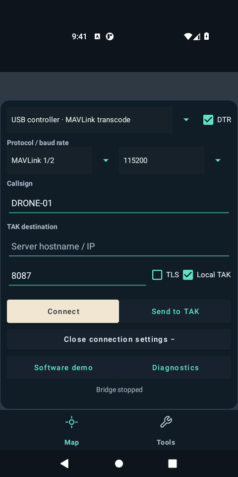
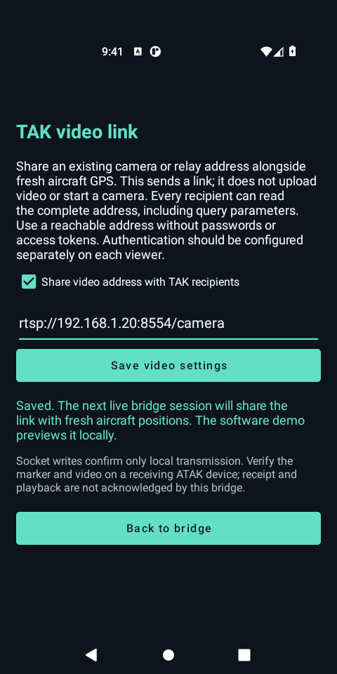
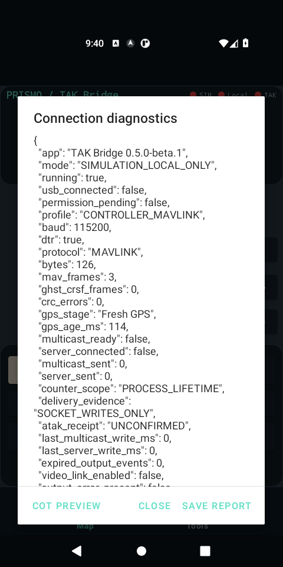
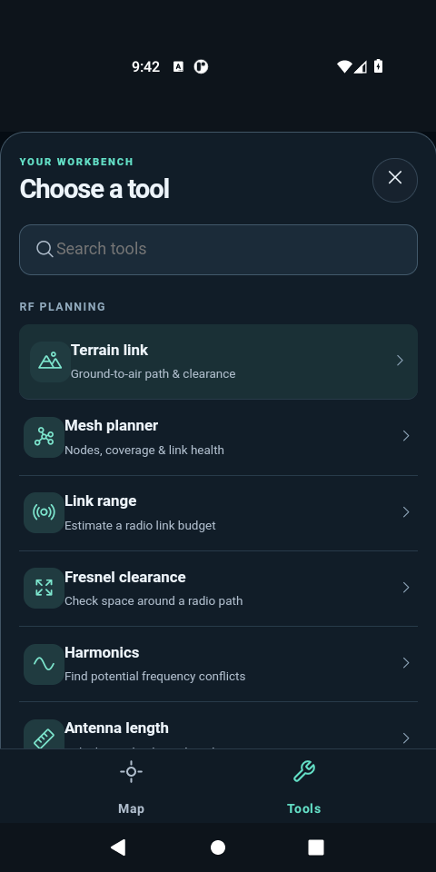

# TAK Bridge User Manual

Prismo / TAK Bridge · Beta 0.5.0-beta.1

## 01. TAK Bridge

Install the Android beta, practice locally, connect an existing GPS stream and verify your aircraft in TAK.

### Beta 0.5.0-beta.1

<a href="https://github.com/DroneWuKong/MultiProtocol-UAS-TAK-Bridge/releases/tag/v0.5.0-beta.1" color="#147463">Download the APK and companion guides from the GitHub beta release.</a>

| Page | Section |
| --- | --- |
| 02 | Install and try the software demo |
| 03 | Connect USB telemetry |
| 04 | Send positions to TAK |
| 05 | Share an existing RTSP video link |
| 06 | Read status and diagnostics |
| 07 | Use planning tools |
| 08 | Troubleshooting and validation limits |

> **Screenshots from the running app** — Captured directly from the signed beta APK on an Android emulator. Demo data is synthetic; no live aircraft, USB source, TAK receiver or camera is shown.

## 02. Install and try it

### 1 / Download the APK

Open the <a href="https://github.com/DroneWuKong/MultiProtocol-UAS-TAK-Bridge/releases/tag/v0.5.0-beta.1" color="#147463">GitHub beta release</a> on your Android device. Under Assets, choose **TAK-Bridge-0.5.0-beta.1.apk**. The source-code ZIP is for developers; it does not install the app.

### 2 / Install TAK Bridge Beta

Open the downloaded APK. If Android asks, allow your browser or file manager to install this app, then follow the device prompts. Android 8.0 or later is required. Keep normal device protections enabled.

The beta has its own icon and settings. It can coexist with an older TAK Bridge install. Future beta updates must use the same signing key; installing over this beta preserves its app data.

### 3 / Try Software demo

Open **TAK Bridge Beta** and tap **Software demo**. No USB device, TAK server or camera is needed. Watch the coordinates, marker and GPS status. Tap **Stop demo** when finished.

> **Practice stays local** — Demo positions are synthetic. The demo does not send them to a network. Map tile downloads still use the internet; missing tiles do not stop telemetry parsing.

## 03. Connect your telemetry

### 1 / Prepare the source

Use an Android device with USB host/OTG support, an OTG adapter if needed, and a data cable. Your flight controller or telemetry interface must already emit supported GPS messages. USB power or channel/stick data alone is not an aircraft GPS stream.

### 2 / Match Connection settings

Stop the demo. Open **Connection settings**. Choose the profile, protocol and baud matching the existing stream. **Auto (passive)** listens for supported GPS. Set DTR as required by your serial interface. Give the aircraft a callsign.

MAVLink v1/v2, MSP v1/v2 and GHST/CRSF GPS are supported. Only the explicit **Direct FC MSP GPS polling** profile sends GPS read requests (2 Hz). Choosing MSP alone does not enable polling.

### 3 / Connect and confirm GPS

Close settings and tap **Connect**. Select the USB serial port if asked and grant Android USB access. Confirm fresh coordinates and a valid fix. Increasing byte counts without fresh GPS are not enough.

> **Reconnect deliberately** — Stop before changing source settings. A cable disconnect ends the session and clears the position; reconnect explicitly. Physical compatibility with your hardware still needs verification.

## 04. Send a position to TAK

### Choose an output

**Local TAK:** enable it in Connection settings before starting USB. The default multicast destination is **239.2.3.1:6969**. Configure the receiver for that group and port. Wi-Fi isolation, VPNs and multicast filtering can block delivery.

**TAK Server:** enter the hostname and server port, then use **Send to TAK**. Use the port your administrator provides (8087 is the TCP default). Configure the server and receiving client to exchange your CoT events.

### For TLS connections

Enable TLS and open **Certificates**. Import your client .p12 and its password; import a server CA .pem/.crt if required. The hostname must match the server certificate. Passwords stay in memory and must be re-entered after the process ends.

### Verify on the receiver

With fresh real GPS, check that the receiving TAK client shows the correct aircraft, callsign and updated location. Publishing runs about once per second. **Socket writes** counts transport writes, not receipt or display in ATAK.

> **No fresh GPS, no new position** — A connected socket is not a valid fix. Publishing pauses for stale or invalid GPS; previously received markers can remain until the receiving client expires or removes them.

## 05. Share an existing video feed

### 1 / Make the feed reachable

Your camera or relay must already serve an RTSP stream reachable from the receiving TAK device. Example only: **rtsp://192.168.1.20:8554/camera**. This is not a bundled or working camera.

### 2 / Enable the link

Stop the bridge. Open **Connection settings → TAK video link**, enable sharing, enter the address and save. Start telemetry again. The link travels with fresh aircraft GPS in the same CoT event.

### 3 / Check it in ATAK

On the receiving device, verify the aircraft marker, its video association and playback. Routing, camera authentication, codecs and the receiving client determine whether playback works.

> **What the public beta provides** — This feature shares a URL. It does not display video in this app, relay video bytes, create a stream, start a camera or add proprietary accessory support.

The complete address goes to every marker recipient. Do not include credentials or access tokens. To remove it, stop, disable sharing, save and restart with valid GPS. The next position requests removal; a stopped source cannot immediately retract a remote link.

## 06. Read status and diagnostics

### Fresh, stale and no fix

Coordinates come from the telemetry source, not the phone. Tap the coordinate readout to cycle MGRS, decimal degrees, DMS and UTM. CoT always uses decimal degrees. Stale GPS pauses publishing; a previous map position is not a current fix.

### What Diagnostics tells you

**Diagnostics** shows input bytes, parser state, GPS freshness and per-output socket-write counts. Last-write times and expired-event counts help separate source problems from connection problems. Counters cover the app process and may include an earlier session.

Exports omit coordinates, video addresses and credentials. In demo mode, **CoT preview** shows the locally generated event, labeled as simulation. A retained preview can describe an earlier fix; inspect its timestamp and current GPS state.

### Keep control of the session

An active session runs in a foreground service. Switching tabs or apps does not stop it. Use **Stop** or the notification action. Process death requires an explicit restart.

> **For a useful bug report** — Include beta version, Android version, source protocol, reproduction steps and exported diagnostics. Redact addresses, keys and private locations from additional screenshots or logs.

## 07. Use the planning tools

### Open Tools

Use the bottom **Tools** tab, then search or select a calculator. The bundled suite includes channel planning, range estimates, Fresnel clearance, harmonics, antenna sizing, terrain links and mesh planning.

### Know the inputs

Enter the frequencies, distances, antenna heights and other values for your setup. Estimates depend on their assumptions and source data. A calculated coverage area is not a measured link or a confirmed range.

### Offline and online

Tool code and catalogs ship inside the APK. Online map imagery and elevation services require connectivity. Supported local DEM imports can supply offline elevation; an empty map grid is not terrain data.

### Return to the bridge

Tap **Map** to return to telemetry. A running session continues while Tools is open. Stop it explicitly when finished.

> **Video tools are planning tools** — The Tools tab does not add a camera receiver to the public beta. Use a compatible receiving TAK client or another suitable viewer for an existing stream.

## 08. Troubleshooting and limits

| Symptom | Check next |
| --- | --- |
| APK will not install | Use the APK asset, Android 8.0+, enough storage and your device installation policy. Beta uses a separate package. A signature conflict may mean a different beta key; save needed settings before uninstalling. |
| No USB device | Check host/OTG support, data cable, serial port and Android permission. Emulator screenshots do not demonstrate a physical USB connection. |
| Bytes arrive, no GPS | Check protocol/baud and that the source emits supported GPS messages with a valid fix. Heartbeats and channel frames alone are insufficient. |
| Writes increase, no marker | Check server routing, receive group/port, client filters, network isolation and fresh GPS. Socket writes are not receipts. |
| Marker appears, video does not | Test the RTSP address from the receiving device. Check camera availability, routing, codecs and client support. The bridge does not relay video. |
| Blank map | Tiles need network access or a usable existing cache. The coordinate readout and telemetry path work independently. |

### Evidence and remaining checks

Validation covers native unit/lifecycle/transport tests, lint, browser tool checks, signed-APK verification and Android emulator interaction. Illustrations are real screenshots from the signed APK with synthetic demo data where indicated.

Physical USB/GPS, screen-off endurance, deployed TAK routing and receiving-device marker/video playback still need bench validation. This app does not command aircraft or change flight modes. See the release page for checksums and known limitations.
